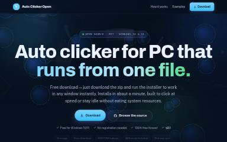

# Click Repeater for PC — Auto-Click Any Mouse Button on a Schedule

A small Windows utility that clicks the left, right, or middle mouse button for you at a chosen interval, toggled with a global hotkey. Built for long form-filling sessions, dialog boxes that need the same click a hundred times, waking up a blocked UI, UI-testing loops, and anything else where a human finger would otherwise be stuck clicking the same spot for an hour. Free, Windows 10 and 11, portable, no account, no ads, no watermark.

The point of a trustworthy **auto clicker** is a predictable rhythm you can walk away from. Pick a button, dial the pace, press the hotkey, come back later.

## Download

**Latest build:** [PCGamingAutoClicker.zip](../../releases/latest/download/PCGamingAutoClicker.zip)

Self-contained archive. Unzip anywhere, run the app from the folder. No installer, no admin prompt.

## Features

- **Left / right / middle click** — pick which button repeats.
- **Interval from 1 ms to 10 minutes** — fast enough for a rapid click, slow enough for an anti-idle heartbeat.
- **Single click or double click per fire** — some targets expect doubles; one toggle, no scripting.
- **Random ± jitter** — add a small random offset to each interval so the pattern does not read as a metronome.
- **Global hotkey** — F6 by default, rebindable to any F1–F12. Starts and stops from any window.
- **Click position** — repeat at the cursor's current location, or lock to a fixed X/Y coordinate picked from the screen.
- **Session counter** — see how many clicks have fired since Start.
- **Dark single-window UI** — no tabs, no settings tree.
- **Zero background services** — close the window, the process ends.

## How to use

1. Launch the app from the folder.
2. Pick left / right / middle, set the interval.
3. Optional: tick **Fixed position** and click the target spot on screen to lock X/Y.
4. Press **Start**, or press **F6** from any other window to toggle.

## FAQ

**Is it really free?**
Yes. Free forever, MIT licensed.

**Does it need an account?**
No. The app does not touch the network at all.

**Does it run on Windows 11?**
Yes. Windows 10 and Windows 11, 64-bit.

**Does it need to be installed?**
No. Portable build — unzip, run, done.

**Is it safe?**
Yes. The app only sends standard mouse events through the operating system. It does not read other processes and does not touch files outside its own folder.

## System requirements

- Windows 10 or Windows 11, 64-bit
- A mouse

## License

MIT.
